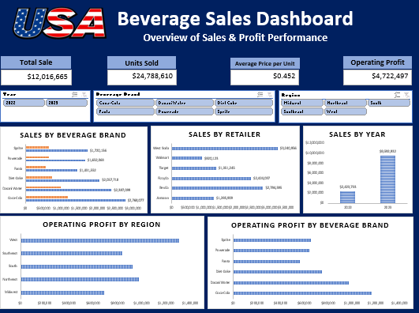
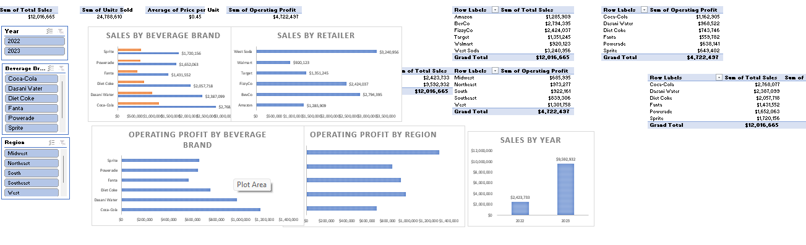

# Sales & Profitability Analytical Dashboard

## Project Overview
An interactive Sales and Profitability Analytical Dashboard developed using Microsoft Excel to analyze retail beverage sales performance, profitability, product trends, and regional business performance.

This project transforms raw sales data into meaningful business insights through KPI summaries, charts, and analytical visualizations.

## Project Objectives
- Analyze overall sales and profitability.
- Evaluate retailer performance.
- Identify regional sales trends.
- Understand beverage brand performance.
- Monitor units sold and average selling price.
- Support data-driven business decisions.

## Tools & Technologies
- Microsoft Excel
- Pivot Tables
- Pivot Charts
- Excel Formulas
- Data Analysis
- Data Visualization

## Dataset Information
- **Records:** 9,648
- **Fields:** 12
- **Domain:** US Beverage Retail Sales

Key fields include:
- Retailer
- Invoice Date
- Region
- State
- City
- Beverage Brand
- Price per Unit
- Units Sold
- Total Sales
- Operating Profit

## Dashboard Highlights

### Key Performance Indicators
- Total Sales: 12,016,665
- Total Units Sold: 24,788,610
- Average Price per Unit: 0.452
- Total Operating Profit: 4,722,496.77

### Analytical Features
- Sales performance analysis
- Retailer-wise performance
- Regional sales analysis
- Beverage brand analysis
- Profitability analysis
- Visual representation of business metrics

## Project Structure

- `Sales & Profitability Analytical Dashboard.xlsx` – Main Excel workbook containing the dashboard, analysis, and raw dataset.

## Business Value
This dashboard helps businesses understand sales performance, compare retailer contributions, evaluate profitability, and identify opportunities for better business decisions.

## Skills Demonstrated
Microsoft Excel | Data Analysis | Business Intelligence | Data Visualization | KPI Reporting | Analytical Thinking

---

**Author:** Neeraj Kumar

**LinkedIn:** [Connect with me](https://www.linkedin.com/in/moogi-neeraj-kumar-827b28296/)
## Dashboard Preview

### Sales & Profitability Dashboard

### Analytical Insights

## Conclusion

This project demonstrates practical skills in Microsoft Excel, data analysis, KPI reporting, data visualization, and business intelligence.
